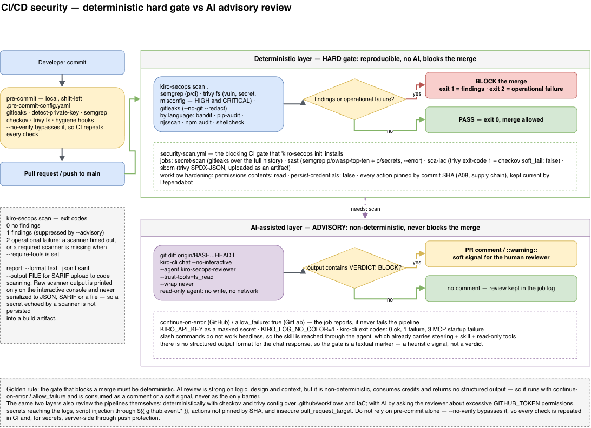

# Pipeline security: `kiro-secops` + Kiro CLI headless

This guide shows how to use this project's **security skills/agent** in **CI/CD** — both to
**review code** and to **review the pipelines themselves** (workflows, IaC).

Use **two layers** (complementary, not competing):

| Layer | Tool | Nature | Role in the pipeline |
|---|---|---|---|
| **Deterministic** | `kiro-secops scan` / scanners (semgrep, trivy, gitleaks, checkov…) | Reproducible, no AI | **Hard gate** (fails the build by severity) |
| **AI-assisted** | `kiro-cli chat --no-interactive --agent kiro-secops-reviewer` | LLM, non-deterministic | **Advisory** (PR comment / design analysis) |

> Golden rule: **the gate that blocks the merge must be deterministic** (scanners). AI review is
> excellent for logic/design/context, but it is **non-deterministic and consumes credits** — use it
> as a comment/warning or a "soft" gate, never as the only barrier.



*Visual diagram — editable source: [`pipeline-cicd-flow.drawio`](diagrams/pipeline-cicd-flow.drawio).*

Official headless mode reference: <https://kiro.dev/docs/cli/headless.md> ·
exit codes <https://kiro.dev/docs/cli/reference/exit-codes.md> ·
auth <https://kiro.dev/docs/cli/authentication.md> ·
permissions <https://kiro.dev/docs/cli/v3/permissions.md>.

---

## 1. Deterministic layer (hard gate) — no AI

No Kiro CLI or credentials needed. Run the baseline scanners:

```bash
kiro-secops scan .        # runs semgrep/bandit/pip-audit/njsscan/npm audit/shellcheck/trivy/gitleaks if present
# or the scanners directly (see internal/assets/payload/workspace/*), or pre-commit:
pre-commit run --all-files
```

This is the recommended pipeline **block**. It is also the same set that `kiro-secops init` installs in
the repository (`.pre-commit-config.yaml`, `.gitleaks.toml`, `trivy.yaml`, `.checkov.yaml`,
`.github/workflows/security-scan.yml`).

---

## 2. AI-assisted layer — Kiro CLI headless

### 2.1 Headless fundamentals (what matters for CI)

- Command: **`kiro-cli chat --no-interactive "PROMPT"`** — prints the **first response to STDOUT**
  and turns off the interactive UI. The **positional prompt is required**.
- **Context via pipe** (standard for review): `git diff | kiro-cli chat --no-interactive "..."`.
- **Select the agent by name**: `--agent kiro-secops-reviewer` (the `/…` slash commands
  **do not work** in headless, so you **cannot** "call" the skill via `/kiro-secops-review`;
  use the **agent**, which already loads the skill + steering + read-only tools).
- **Permissions/trust** (there is no user to approve): the `kiro-secops-reviewer` agent is already
  **read-only** (`fs_read: allow`, `fs_write: deny`, network denied). To ensure read auto-approval in
  headless, pass `--trust-tools=fs_read` (or `--trust-all-tools`, less advisable).
  The `permissions.yaml` rules still apply (deny > ask > allow).
- **Output/gate:** **there is no JSON format** for the chat response. To *trigger* the pipeline,
  ask the agent to **print a marker** (e.g.: `VERDICT: PASS|BLOCK`) and run `grep`.
  **Exit codes**: `0` success, `1` general failure, `3` MCP startup failure (with
  `--require-mcp-startup`).
- **Clean logs:** `KIRO_LOG_NO_COLOR=1` and `--wrap never`.

### 2.2 Authentication in CI

Use an **API key** via an environment variable (store it as a **secret**, never commit it):

```bash
export KIRO_API_KEY=ksk_xxxxxxxx      # CI secret
kiro-cli whoami                        # checks the credential
```

Requires a **Kiro Pro/Pro+/Pro Max/Power** plan; if the account is managed by an admin, they must
**enable API key generation**. Install the CLI **without `curl | sh`**: download the official zip over
HTTPS and run the bundled `install.sh` (see the step in
[`examples/kiro-headless-ci/Dockerfile.review`](../examples/kiro-headless-ci/Dockerfile.review)),
or use the ready-made Docker images in the same folder.

### 2.3 Prerequisites on the runner

1. Install **`kiro-secops`** (release binary or build) and run **`kiro-secops install`** —
   this deploys the `kiro-secops-reviewer` agent, the `kiro-secops-review` skill, the steering, and the
   `permissions.yaml` in `~/.kiro` (respects `KIRO_HOME`).
2. Install **`kiro-cli`** and export **`KIRO_API_KEY`**.
3. (Optional) install the scanners the agent can invoke (semgrep/trivy/…), if you want
   the AI review to also run tools.

### 2.4 Reference command (diff review)

```bash
export KIRO_API_KEY=ksk_xxxxxxxx
export KIRO_LOG_NO_COLOR=1

out="$(git diff "origin/${BASE:-main}...HEAD" | kiro-cli chat \
  --no-interactive \
  --agent kiro-secops-reviewer \
  --trust-tools=fs_read \
  --wrap never \
  "Review the diff above (provided in the context) for OWASP Top 10 / CWE vulnerabilities, \
hardcoded secrets, and vulnerable dependencies. For each finding: severity, file:line, \
CWE/OWASP, and fix. On the LAST line print exactly 'VERDICT: BLOCK' if there are \
Critical/High, otherwise 'VERDICT: PASS'.")"

echo "$out"
if grep -q '^VERDICT: BLOCK' <<<"$out"; then
  echo "Security review (AI) flagged Critical/High."
  exit 1     # soft gate — see caveats
fi
```

---

## 3. Reviewing the **pipelines themselves** (workflows / IaC)

Point the review at the pipeline/infra files instead of the code diff:

```bash
# 1) deterministic: policy-as-code and IaC/CI misconfig
kiro-secops scan .                 # includes trivy config / checkov
checkov -d .github/workflows    # and/or .gitlab-ci.yml, Jenkinsfile, terraform/

# 2) AI-assisted: workflow review (broad permissions, secrets, injection in ${{ }} etc.)
cat .github/workflows/*.yml | kiro-cli chat --no-interactive --agent kiro-secops-reviewer \
  --trust-tools=fs_read --wrap never \
  "Review these CI workflows: excessive GITHUB_TOKEN permissions, use of secrets in logs, \
script injection via \${{ github.event.* }}, actions not pinned by SHA (supply chain, A03), \
insecure pull_request_target. List severity, file, and fix. Last line: 'VERDICT: PASS|BLOCK'."
```

Typical pipeline security checks the review covers: minimal `permissions:`, actions
**pinned by commit SHA**, no `curl | sh` in steps, secrets never in `echo`/logs, no
`pull_request_target` with untrusted code checkout, and OIDC instead of static keys.

---

## 4. Complete examples

> The examples below obtain `kiro-secops` from a **Release of your own fork** (replace
> `SEU-ORG`). Since this sample **does not publish releases**, first generate the installable in your
> fork (see [`examples/release/`](../examples/release/)) — or build from source (`go build ./cmd/kiro-secops`),
> or use the Docker images from [`examples/kiro-headless-ci/`](../examples/kiro-headless-ci/), which
> already embed the binary.

### 4.1 GitHub Actions

```yaml
name: security
on: [pull_request]

permissions:
  contents: read

jobs:
  # HARD gate (deterministic) — blocks the merge
  scan:
    runs-on: ubuntu-latest
    steps:
      - uses: actions/checkout@v4
      - name: Install kiro-secops
        run: |
          VER=1.1.0   # pin the desired release version
          curl -fsSL -o ks.tar.gz "https://github.com/SEU-ORG/sample-kiro-secops-baseline/releases/download/v${VER}/kiro-secops_${VER}_linux_amd64.tar.gz"
          tar -xzf ks.tar.gz kiro-secops && sudo mv kiro-secops /usr/local/bin/
      - name: Scanners (fails on Critical/High)
        run: kiro-secops scan .

  # ADVISORY (AI) — comments/flags, is not the main barrier
  ai-review:
    runs-on: ubuntu-latest
    needs: scan
    steps:
      - uses: actions/checkout@v4
        with: { fetch-depth: 0 }
      - name: Install kiro-cli + kiro-secops
        run: |
          VER=1.1.0
          # Kiro CLI: official zip verified over HTTPS (no 'curl | sh')
          curl --proto '=https' --tlsv1.2 -fsSL 'https://desktop-release.q.us-east-1.amazonaws.com/latest/kirocli-x86_64-linux.zip' -o kirocli.zip
          unzip -q kirocli.zip && ./kirocli/install.sh --no-confirm </dev/null && export PATH="$HOME/.local/bin:$PATH"
          curl -fsSL -o ks.tar.gz "https://github.com/SEU-ORG/sample-kiro-secops-baseline/releases/download/v${VER}/kiro-secops_${VER}_linux_amd64.tar.gz"
          tar -xzf ks.tar.gz kiro-secops && ./kiro-secops install
      - name: Security review (headless)
        env:
          KIRO_API_KEY: ${{ secrets.KIRO_API_KEY }}
          KIRO_LOG_NO_COLOR: "1"
        run: |
          out="$(git diff origin/${{ github.base_ref }}...HEAD | \
            kiro-cli chat --no-interactive --agent kiro-secops-reviewer \
              --trust-tools=fs_read --wrap never \
              "Review the diff for OWASP/CWE, secrets, and deps. Last line: 'VERDICT: PASS' or 'VERDICT: BLOCK'.")"
          echo "$out"
          grep -q '^VERDICT: BLOCK' <<<"$out" && echo "::warning::Security review flagged Critical/High." || true
```

### 4.2 GitLab CI

```yaml
stages: [security]

sec-scan:              # hard gate
  stage: security
  image: public.ecr.aws/docker/library/ubuntu:24.04
  script:
    - VER=1.1.0; curl -fsSL -o ks.tar.gz "https://github.com/SEU-ORG/sample-kiro-secops-baseline/releases/download/v${VER}/kiro-secops_${VER}_linux_amd64.tar.gz" && tar -xzf ks.tar.gz kiro-secops
    - ./kiro-secops scan .

ai-review:             # advisory
  stage: security
  image: public.ecr.aws/docker/library/ubuntu:24.04
  allow_failure: true  # does not block the merge (advisory)
  variables:
    KIRO_LOG_NO_COLOR: "1"
  script:
    # Kiro CLI: official zip verified over HTTPS (no 'curl | sh')
    - curl --proto '=https' --tlsv1.2 -fsSL 'https://desktop-release.q.us-east-1.amazonaws.com/latest/kirocli-x86_64-linux.zip' -o kirocli.zip && unzip -q kirocli.zip && ./kirocli/install.sh --no-confirm </dev/null && export PATH="$HOME/.local/bin:$PATH"
    - VER=1.1.0; curl -fsSL -o ks.tar.gz "https://github.com/SEU-ORG/sample-kiro-secops-baseline/releases/download/v${VER}/kiro-secops_${VER}_linux_amd64.tar.gz" && tar -xzf ks.tar.gz kiro-secops && ./kiro-secops install
    - |
      git diff "origin/$CI_MERGE_REQUEST_TARGET_BRANCH_NAME...HEAD" | \
        kiro-cli chat --no-interactive --agent kiro-secops-reviewer --trust-tools=fs_read --wrap never \
        "Review the diff for OWASP/CWE, secrets, and deps. Last line: 'VERDICT: PASS|BLOCK'."
  # KIRO_API_KEY defined as a masked and protected CI/CD variable
```

### 4.3 Ready-made Docker images (forkable)

Instead of installing `kiro-cli` + `kiro-secops` in every job, use the example image in
[`examples/kiro-headless-ci/`](../examples/kiro-headless-ci/): a **review** image (modes
`review`, `pipeline`, and `dast-triage`) that embeds the `kiro-secops-reviewer` agent, installs the
Kiro CLI **without `curl | sh`** (official zip verified over HTTPS/TLS, with an optional
`--build-arg KIRO_CLI_SHA256`), uses **ECR Public** bases, and runs as a **non-root** user. The
**DAST scanner** (ZAP/Nuclei) is **BYO** — you generate the report and the image does the **AI triage**
(`dast-triage`). The folder includes `entrypoint.sh`, editable prompts, and example workflows for
GitHub Actions and GitLab.

```bash
# build context = repo root (compiles kiro-secops from source)
docker build -f examples/kiro-headless-ci/Dockerfile.review -t kiro-secops-review:ci .
docker run --rm -e KIRO_API_KEY -e BASE_REF=origin/main -v "$PWD:/workspace" \
  kiro-secops-review:ci review
```

---

## 5. Caveats (read before trusting the AI gate)

- **Non-determinism:** the same input can produce different outputs. **Do not** make the AI review the
  only merge barrier — the real gate is the deterministic scanner.
- **No structured output:** since there is no JSON for the chat response, the gate relies on a
  **textual marker** (`VERDICT: BLOCK`). It's heuristic; treat it as a signal, not as truth.
- **Cost/latency:** each run consumes credits and adds time. Run it on PRs (not on every push), or
  only when the diff touches sensitive areas (auth/crypto/IaC).
- **Credentials:** `KIRO_API_KEY` always as a masked **secret**; rotate/revoke it; never in logs.
  In fork PRs, secrets are not exposed by default — plan according to your policy.
- **Least privilege:** prefer `--agent kiro-secops-reviewer` (read-only) + `--trust-tools=fs_read`.
  Avoid `--trust-all-tools` in CI unless you need the agent to run scanners that write files.
- **Undocumented gaps** (kiro.dev): the exact precedence between `--trust-tools` and
  `permissions.yaml`, and the behavior when a tool would require `ask` without a terminal — validate on
  your runner before relying on it.

---

## 6. Summary

1. **Hard gate** = `kiro-secops scan` / deterministic scanners (fails by severity).
2. **Advisory** = `kiro-cli chat --no-interactive --agent kiro-secops-reviewer` (code and pipeline
   review), with a `KIRO_API_KEY` secret, `--trust-tools=fs_read`, and a soft gate via
   `VERDICT:`.
3. **Never** trust the AI alone to block a merge; it **complements** the scanners.
