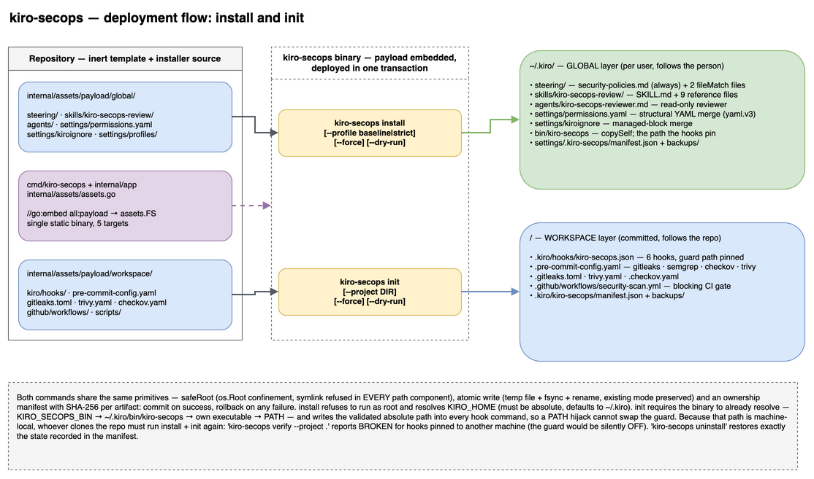
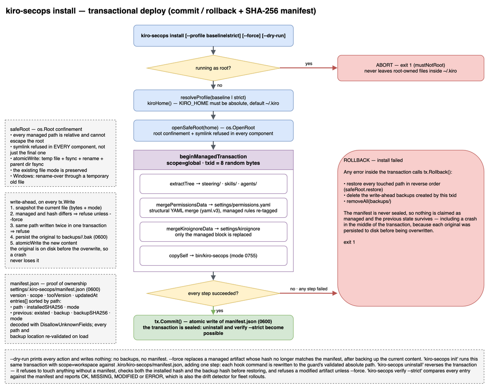
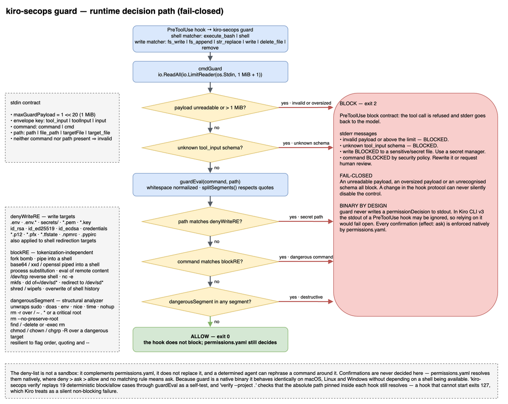

# Solution architecture

Technical document for the `kiro-secops` solution. For Kiro's **security mechanisms**,
see [SECURITY-BASELINE](../security/SECURITY-BASELINE.md).

## Overview

The repository is, at the same time:

1. A **template** — the baseline lives as an **inert payload** in `internal/assets/payload/` (it does not configure this repo);
2. The **installer source** — a Go binary that **embeds** `internal/assets/payload/` via `//go:embed` and
   deploys it onto the user's machine.

*Visual diagram — editable source: [`deployment-flow.drawio`](../diagrams/deployment-flow.drawio).*

## Layered model: *guidance* vs *enforcement*

| Layer | Target | Nature | Blocks? |
|---|---|---|:--:|
| **Permissions** | `~/.kiro/settings/permissions.yaml` | **hard** enforcement (global, agent-agnostic) | Yes |
| **Hooks** | `.kiro/hooks/*.json` (workspace) | event-driven automation (calls `kiro-secops guard`) | Yes |
| **Custom Agent** | `~/.kiro/agents/kiro-secops-reviewer.md` | tool *scoping* (read-only) | Partial |
| **Steering/Skills** | `~/.kiro/{steering,skills}/` | guidance (soft) | No |

**Declarative-first** decision: global blocking lives in `permissions.yaml` (no runtime,
cross-platform); event hooks (review/SDD and rich regex-based guard) are per-workspace.

## Payload: global vs workspace

- **`internal/assets/payload/global/` → `~/.kiro/`** (follows the person; installed once): steering, skills, agent,
  `settings/permissions.yaml`, `settings/kiroignore`.
- **`internal/assets/payload/workspace/` → the project's `.kiro/`** (follows the project; committed): hooks, reference
  scripts, and scanner/CI configs.

## Code map

**Thin** entry point in `cmd/`, logic in `internal/app` (package `app`), and payload embedded in `internal/assets`.

| File | Responsibility |
|---|---|
| `cmd/kiro-secops/main.go` | Thin entry point: `os.Exit(app.Run(os.Args[1:]))` |
| `internal/app/cli.go` | Subcommand dispatch, flags, `usage`, `Run`/`run`, `opts`, `version` |
| `internal/assets/assets.go` | `//go:embed all:payload` → `assets.FS` (the payload lives alongside) |
| `internal/app/assets.go` | bridge `payloadFS = assets.FS` (keeps the package identifier) |
| `internal/app/kirohome.go` | `kiroHome()` (respects `KIRO_HOME`), `mustNotRoot`, `firstString` |
| `internal/app/safefs.go` | `safeRoot` (via `os.Root`): root confinement, anti-symlink (all components), atomic write (temp+`fsync`+`rename`), mode preservation |
| `internal/app/manifest.go` | ownership manifest (SHA-256 hash), transaction (`Write`/`Commit`/`Rollback`), `restoreManaged`, `verifyManaged` |
| `internal/app/hooks.go` | guard binary resolution/validation + absolute path materialization in the hooks |
| `internal/app/fsutil.go` | `extractTree`/`copyEmbedFile`/`walkEmbedFiles`/`copySelf` (from the embed, within the transaction) |
| `internal/app/guard.go` | `guardEval` (block/allow, **fail-closed**), `blockRE`/`denyWriteRE` regex, `cmdGuard` (stdin) |
| `internal/app/merge.go` | `mergePermissionsData` (**structural** YAML merge via `yaml.v3`), `mergeKiroignoreData` (managed block) |
| `internal/app/install.go` | `cmdInstall`, `cmdUninstall`, `cmdUninstallProject`, `binName`, `pathHint` |
| `internal/app/initcmd.go` | `cmdInit` (copies hooks + configs from `internal/assets/payload/workspace/`) |
| `internal/app/scan.go` | `cmdScanWithOptions` (detects language, runs scanners with timeout; blocking/advisory) |
| `internal/app/verify.go` | `cmdVerify` (guard self-test + global integrity with `--strict` + workspace hooks/manifest with `--project`) |

`internal/app/*_test.go` cover the guard (incl. fail-closed), structural merge, safefs (symlink/rollback),
manifest/restoration/tampering, install/uninstall (global and `--project`), init, verify `--strict`,
hooks, and the PATH hint.

## Flows

**install** → resolves `KIRO_HOME`; refuses root; opens `safeRoot`; within a **transaction**: `extractTree`
of steering/skills/agents, `mergePermissionsData` + `mergeKiroignoreData`, `copySelf` to
`~/.kiro/bin`; **commit** writes the manifest (backing up the originals); on failure, **rollback**.

**init** → resolves/validates the project directory; **resolves and validates the guard binary** (fails if
absent); within a transaction, materializes `.kiro/hooks/kiro-secops.json` with the binary's **absolute
path** and copies the scanner/CI configs.

**guard** (hot-path) → reads JSON from stdin (bounded) → `guardEval(cmd, path)`:
`denyWriteRE(path)` → 2; otherwise it normalizes the command and tests `blockRE` → 2; otherwise 0 (allows).
Invalid JSON/unknown schema/large payload → 2 (**fail-closed**). Confirmation (`ask`) is the
responsibility of `permissions.yaml`, not the hook.

*`install` — transactional deploy (commit / rollback + SHA-256 manifest). Editable source: [`install-transaction-flow.drawio`](../diagrams/install-transaction-flow.drawio).*

*`guard` — runtime decision (fail-closed). Editable source: [`guard-runtime-flow.drawio`](../diagrams/guard-runtime-flow.drawio).*

## Hardening

- **`KIRO_HOME`** validated as an **absolute** path; defaults to `~/.kiro`.
- **No root** (`mustNotRoot`) — avoids root-owned files in `~/.kiro`.
- **Root confinement** via `os.Root`: refuses symlinks in **any** path component
  (parent or final), not just the final target (anti-TOCTOU/anti-escape).
- **Atomic write** (temp + `fsync` + `rename`), preserving the existing file's mode.
- **Transaction + manifest** (SHA-256 hash): rollback on failure; `uninstall` restores the previous
  state exactly and refuses to remove a modified artifact without `--force`.
- **Fail-closed guard**: a protocol change/unexpected input blocks, it does not allow.
- **JSON/YAML generation** via `encoding/json`/`yaml.v3` (never `sed`) — no breakage from special characters.
- **Minimal dependency surface:** stdlib + `gopkg.in/yaml.v3` (single dependency, pinned).

## Cross-platform

A single source base cross-compiles to darwin/linux/windows (amd64/arm64). The Linux binaries
are **static** (`CGO_ENABLED=0`). The `guard` runs as a native binary (without relying on `bash`),
which solves the "non-portable shell on Windows" problem.

## Namespacing and coexistence

`kiro-secops-*` names avoid collision with same-named artifacts from other plugins. `kiro-secops`
**does not depend** on any other plugin. Merges preserve the user's existing config.

## Known limitations

- The `guard` denylist **is not a sandbox** (it can be bypassed); it is a layer complementary to
  `permissions.yaml`.
- The `~/.kiro` layer is **user-editable** — it is a personal floor, not fleet policy. The
  tamper-resistant home for `deny`/`ask` rules is Kiro's **Administration** scope (enterprise
  plans; not overridable by user/workspace rules), whose file deployment path is not publicly
  documented — distribution goes through enterprise tooling/**MDM with drift correction**
  (`verify --strict` is the detector). Template + rollout guide:
  [`ENTERPRISE.md`](../security/ENTERPRISE.md).
- Global steering avoids `#[[file:...]]` (resolution not guaranteed outside the workspace) → inline content.
